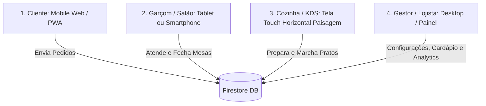

# Guia de Especificação e Wireframes • MAYaMenu

Este documento serve como a **Bússola de Design (Wireframing Guide)** para a equipe de UX/UI, designers de produto e desenvolvedores de frontend. Ele detalha os fluxos de ponta a ponta, a hierarquia de informação, a anatomia das telas e as regras operacionais validadas do **MAYaMenu**.

---

## 1. Visão Geral do Ecossistema

O MAYaMenu opera em quatro perfis de uso com necessidades visuais e ergonômicas bem distintas:

---

## 2. Visão do Cliente (Mobile-First / PWA)

Projetado para telas compactas verticais (viewport 360px a 430px de largura). Deve ser instantâneo, visualmente apetitoso e sem atritos ou necessidade de login prévio com senha.

### 2.1. Tela Principal do Cardápio (`MenuView`)

#### Hierarquia e Blocos de Conteúdo:
1. **Topo Fixo (Header):**
   - Imagem de capa rústica com sobreposição gradiente escurecida.
   - Logo/Avatar do restaurante + Nome do estabelecimento.
   - Badge com a identificação da mesa: `Mesa 12` (ou ícone para escanear/trocar mesa).
   - Botão de Busca (lupa expansível).
   - Botão de Acesso Rápido à Comanda (com indicador pulsante caso haja pedidos ativos).
2. **Barra de Ações Rápidas (Chips):**
   - Botão *"Chamar Garçom"* (oculto no modo *Autoatendimento/Balcão*, com cooldown anti-flooding visual de 120s).
   - Botão *"Pedir Conta / Pagar"*.
   - Botão *"Histórico / Comprovantes"*.
3. **Carrossel Horizontal de Categorias (Pills Fixas ao Rolar):**
   - Chips deslizantes: `Todas`, `Hambúrgueres`, `Pizzas`, `Bebidas`, `Sobremesas`, etc.
4. **Lista de Pratos (Grid 1 Coluna no Mobile):**
   - Card de Item:
     - Foto destaque (proporção quadrada ou 4:3 com cantos arredondados).
     - Nome em negrito + descrição curta (2 linhas no máximo).
     - Preço base destacado.
     - Botão `Adicionar` ou `Montar` (se tiver adicionais/modificadores).
     - Badge se esgotado/pausado (`Indisponível`).
5. **Barra Flutuante Inferior (Sticky Action Bar):**
   - **Estado A (Itens no Carrinho Local):** Banner com cor primária da marca, indicando total de itens, subtotal e botão *"Enviar Pedido / Carrinho"*.
   - **Estado B (Sem carrinho, mas com pedidos na mesa):** Botão escuro discreto *"Minha Comanda Ativa"* exibindo o valor acumulado em tempo real.

---

### 2.2. Modal de Montagem de Prato (`ItemModal`)

Disparado ao clicar em um prato que possui complementos.

- **Formato:** Dialog / Bottom-Sheet com bordas superiores arredondadas (`rounded-t-3xl`), ocupando até 95% da altura da tela (`95dvh`).
- **Anatomia:**
  - **Topo:** Botão flutuante translúcido de fechar (`X`) no canto superior direito sobre a foto.
  - **Foto de capa grande** com gradiente inferior.
  - **Título do prato**, descrição completa e preço inicial base.
  - **Seções de Modificadores (Agrupamentos):**
    - Cabeçalho do grupo: Nome (ex: *"Ponto da Carne"*), indicador de *"Obrigatório"* e contador de limites (ex: *"Escolha 1 opção"* ou *"Escolha de 1 a 3"*).
    - Opções: Radio button visual (quando `maximo = 1`) ou Checkbox (quando `maximo > 1`). Se houver acréscimo de valor, exibir `+ R$ 5,00`.
    - Bloqueio inteligente: Se atingiu o máximo, desabilita visualmente as opções não selecionadas.
  - **Campo de Observações:** Textarea para pedidos especiais (ex: *"Sem cebola, molho à parte"*).
  - **Rodapé Fixo:**
    - Seletor de quantidade `[-] 1 [+]`.
    - Botão largo de ação com preço total recalculado dinamicamente: `Adicionar • R$ 42,00`. Desabilitado enquanto os grupos obrigatórios não forem satisfeitos.

---

### 2.3. Gaveta de Checkout e Envio (`CartDrawer`)

- **Formato:** Bottom Sheet deslizante com revisão dos itens.
- **Conteúdo:**
  - Campo obrigatório de texto: *"Seu Nome na Mesa"* (ex: *"Marcus"*, sem cadastro formal).
  - Listagem dos pratos com badges dos modificadores selecionados e controle de quantidade individual.
  - Resumo financeiro: Subtotal + Linha da Taxa de Serviço (ex: 10%) + Total Geral.
  - Botão principal: *"Enviar Pedido • Gerar Ticket"*.
  - **Tela de Sucesso Instantânea (Fallback / Contingência Offline):**
    - Ícone de sucesso animado.
    - **MAYa Sync-QR:** Renderização de QRCodeSVG contendo o comprovante criptografado/comprimido para que o cliente possa mostrar ao garçom caso a conexão caia.

---

### 2.4. Acompanhamento da Comanda (`MinhaComandaModal`)

- **Objetivo:** Dar visibilidade e transparência ao cliente sobre tudo o que já foi enviado para a cozinha.
- **Estrutura:**
  - Lista de rodadas: `Rodada #1`, `Rodada #2`.
  - Badges de Status por item/rodada:
    - `Na Cozinha` (Amarelo / Spinner).
    - `Pronto p/ Servir` ou `Pronto p/ Retirar` (Verde animado).
    - `Entregue na Mesa` ou `Retirado` (Cinza neutro).
    - `Cancelado` / `Estornado` (Vermelho discreto).
  - Bloco de Rateio de Mesa:
    - `"A Minha Comanda"` (somente o consumo do cliente).
    - `"Total da Mesa"` (consumo conjunto de todos os presentes na mesa).
  - Botão de solicitação de encerramento (`Pedir Conta`).

---

## 3. Visão do Garçom / Salão (`GarcomView`)

Otimizado para agilidade e uso com uma mão só (smartphones Android/iOS) ou tablets de serviço.

### 3.1. Grid do Salão
- **Status da Mesa em Cores Vivas e Reconhecíveis:**
  - **Livre:** Fundo escuro/neutro, sem ocupantes.
  - **Ocupada:** Borda/badge azul ou roxo com quantidade de clientes e pratos em preparo.
  - **Chamando Garçom:** Alerta pulsante amarelo com cronômetro de espera e motivo do chamado.
  - **Conta Pedida:** Destaque em vermelho/rosa alertando necessidade de fechamento.
  - **Paga / Ocupada:** Verde (alerta de tolerância de tempo/upsell).
- **Banner de Pratos Prontos na Cozinha (Bandeja):**
  - Lista de pratos que saíram do KDS e precisam ser entregues na mesa imediatamente, com botão rápido: `[Marcar Entregue]`.

### 3.2. Modal de Detalhe da Mesa (`MesaDetalheModal`)
- **Abas Internas:**
  1. **Comandas:** Exibe clientes individuais, pratos que cada um consumiu, status de entrega e botão de fechamento individual ou coletivo.
  2. **Lançar:** Permite ao garçom lançar itens manualmente para a mesa (para clientes que não usam celular).
  3. **QR Code da Mesa:** Exibe o QR Code para impressão rápida ou escaneamento direto da mesa.
- **Ações Críticas:**
  - Checkbox/Toggle para ligar/desligar a **Taxa de Serviço**.
  - Botão vermelho destacado: *"Encerrar e Liberar Mesa"*.

---

## 4. Visão da Cozinha / KDS (`KdsView`)

Projetada exclusivamente para **telas em modo paisagem (16:9 ou 16:10)** montadas na parede ou balcão da cozinha (tablets de 10" ou monitores touch de 21"+).

### Diretrizes de Wireframe:
1. **Contraste Extremo:** Fundo escuro (`#0a0a0a`) com cartões em contraste para não cansar a vista e suportar ambientes com iluminação quente.
2. **Estrutura dos Cards de Pedidos (Colunas Horizontais):**
   - **Cabeçalho:** Número da Mesa em tamanho gigante (`Mesa 04`) + Nome do Cliente + Tempo decorrido (`Há 8 min`).
   - **Corpo:** Lista dos itens em tipografia grande:
     - `2x MAYaBurger Especial`
     - Modificadores em cor de destaque (ex: âmbar/rosa): `Ao Ponto, Bacon Duplo`.
     - Observações em itálico evidente: `* Obs: Sem cebola *`.
   - **Rodapé do Card (Botão de Ação Tátil Gigante):**
     - Se `a_fazer`: Botão grande verde *"MARCHAR / PRONTO"*.
     - Se `pronto`: Botão para retornar ou enviar para entrega.
3. **Modos de Fila:**
   - **Sequencial:** Ordenação simples por ordem de chegada (FIFO).
   - **Agrupamento Ágil:** Agrupa os pratos da mesma mesa para saírem juntos na mesma rodada.

---

## 5. Visão Administrativa / Dashboard (`AdminDashboard`)

Projetada para monitores desktop/laptops (1280px a 1920px). Layout com barra lateral (Sidebar) e área central fluida.

### Telas e Módulos:
1. **Gestão do Cardápio:**
   - Lista/Grid com ordenação arrastável (Drag and Drop ou setas de subida/descida).
   - Toggle switch instantâneo de disponibilidade: `Ativo / Pausado (Esgotado)`.
   - **Modal de Cadastro/Edição de Prato:**
     - Cabeçalho e rodapé de salvar fixos (`sticky`), miolo com scroll independente.
     - Construtor visual de modificadores integrado (`ModificadorBuilder`).
2. **Monitor do Salão:**
   - Visão espelho do salão com capacidade de monitoramento em tempo real.
3. **Configurações do Restaurante:**
   - Seletor de Tema e Cor Primária (injetada no Tailwind com preview ao vivo).
   - **Modo de Operação:** `Com Garçom`, `Híbrido` ou `Autoatendimento / Balcão`.
   - Percentual da Taxa de Serviço (sugestões rápidas de 0%, 10%, 12%, 15%).
4. **Analytics e Inteligência (MAYa Analytics):**
   - Indicadores-chave: Faturamento do dia, ticket médio por mesa, pratos mais vendidos e tempo médio de permanência.

---

## 6. Checklist de Wireframing para a Equipe de UI

| # | Item de Validação | Regra / Observação |
|---|---|---|
| **1** | **Sem Login para o Cliente** | O fluxo de entrada do cliente nunca deve solicitar e-mail, senha ou cadastro pesado. Apenas o nome opcional ao fechar o carrinho. |
| **2** | **Touch Targets Mínimos** | Qualquer botão de ação em mobile ou no KDS deve ter altura mínima de **48px a 56px** para evitar toques acidentais. |
| **3** | **Modo Balcão x Garçom** | Quando a flag `modoOperacao == 'balcao'` estiver ativa, todos os elementos visuais de garçom (chamar garçom, garçom-view) devem ser ocultados ou substituídos por instruções de retirada no balcão. |
| **4** | **Transparência de Preço** | Toda opção com valor adicional deve deixar o acréscimo explícito (`+ R$ X,XX`) antes do clique. |
| **5** | **Feedback Offline** | Telas que envolvam pedidos devem prever estados visuais com indicador de rede fraca e apresentação do Sync-QR. |
